<p align="center">
  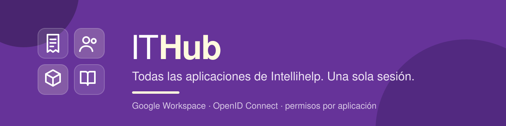
</p>

<p align="center">
  <b>Portal único de Intellihelp: todas las aplicaciones internas detrás de una sola sesión de Google Workspace.</b><br>
  Proveedor de identidad propio (OpenID Connect), permisos por aplicación, cierre de sesión en todas las apps y auditoría.
</p>

<p align="center">
  
  
  
  
  
  
</p>

---

## Índice

- [Descripción](#descripción)
- [La aplicación por dentro](#la-aplicación-por-dentro)
- [Cómo funciona la sesión única](#cómo-funciona-la-sesión-única)
- [Permisos](#permisos)
- [Aplicaciones](#aplicaciones)
- [Stack técnico](#stack-técnico)
- [Estructura del proyecto](#estructura-del-proyecto)
- [Puesta en marcha](#puesta-en-marcha)
- [Tests](#tests)
- [Seguridad](#seguridad)
- [Licencia](#licencia)
- [Autor](#autor)

## Descripción

Intellihelp tiene hoy una aplicación por cada área —facturación, CRM, remitos, inventario,
RRHH, mesa de ayuda, wiki, tareas— y cada una con su propio login, sus propios usuarios y sus
propios permisos. **ITHub las unifica**:

- **Una sola sesión.** Se entra una vez con la cuenta de Google `@intellihelp.tech` y desde el
  panel se abre cualquier aplicación sin volver a loguearse.
- **Permisos centralizados.** En ITHub se define a qué aplicaciones entra cada persona y con
  qué rol en cada una. Quien no tiene permiso no ve la tarjeta y, aunque escriba la dirección,
  ITHub no lo deja pasar.
- **Una sola salida.** Cerrar sesión —o que un administrador cierre la de alguien, o lo dé de
  baja— corta el acceso en todas las aplicaciones a la vez.
- **Auditoría.** Quién entró, a qué aplicación, con qué rol, y quién cambió qué permiso.

Sin contraseñas: el acceso es sólo con Google Workspace.

> En producción: **`https://ithub.intellihelp.tech`**. La aplicación de facturación, que
> antes estaba en esa dirección, pasa a `https://facturacion.intellihelp.tech` y queda como
> una tarjeta más del panel.

## La aplicación por dentro

Identidad visual compartida con el CRM y el Portal de RRHH: tipografía Saira y paleta
`#663399` · `#9f88b1` · `#fff6ff` · `#fffade`, con colores planos y sin degradados. ITHub es
la puerta de entrada a esas aplicaciones y se ve como parte de la misma familia.

> Las capturas son de una instalación local con el mismo código y el catálogo real de
> aplicaciones; los únicos usuarios son los dos super admin.

<p align="center">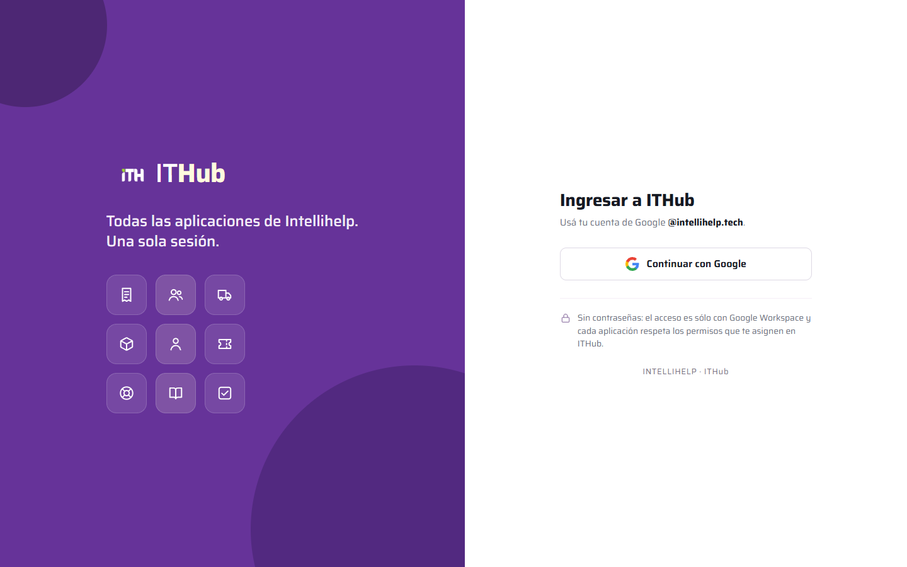</p>

### Panel

Una tarjeta por aplicación, con el rol de la persona en cada una, filtros por categoría y
buscador (atajo <kbd>/</kbd>). Los administradores ven además el resumen del día.

<p align="center">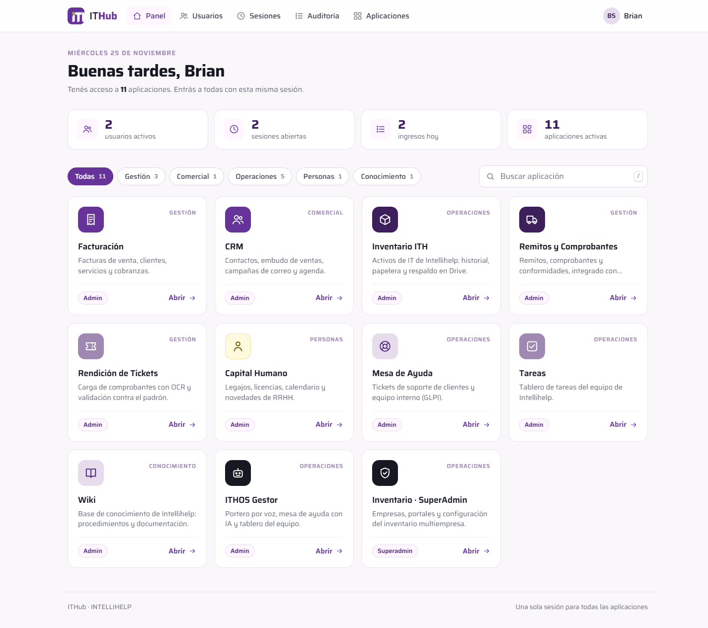</p>

### Usuarios y permisos por aplicación

<p align="center">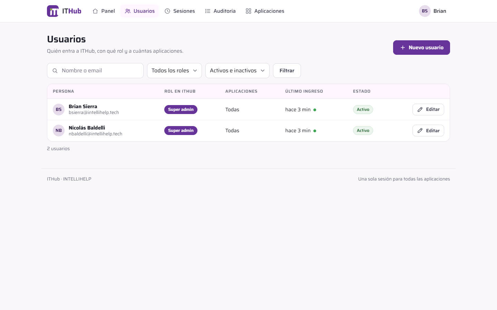</p>
<p align="center">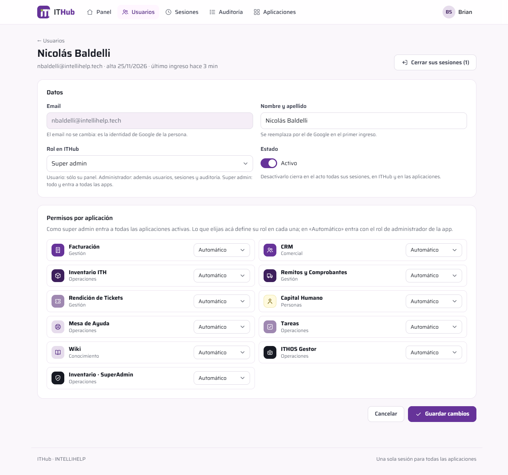</p>

### Catálogo de aplicaciones

<p align="center">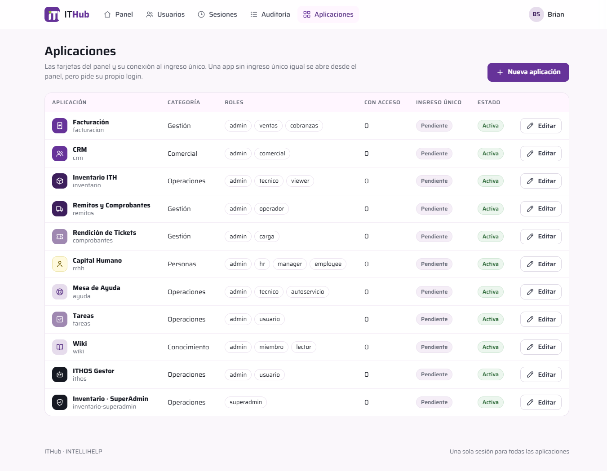</p>
<p align="center">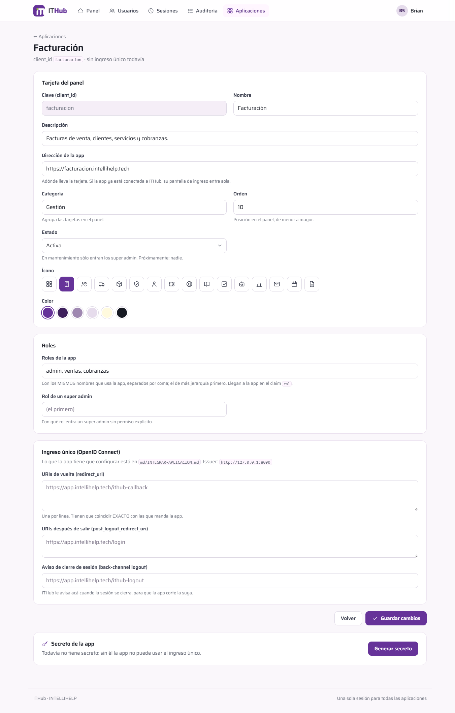</p>

### Sesiones, auditoría y cuenta

<p align="center">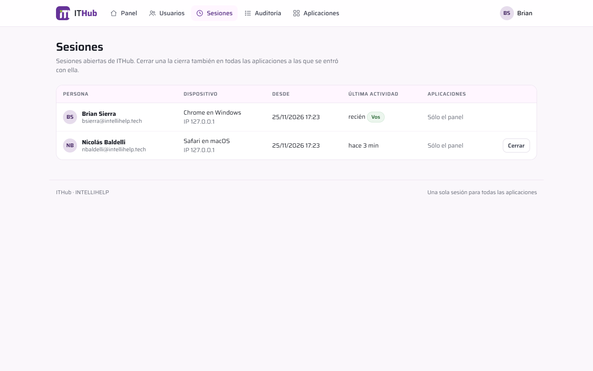</p>
<p align="center">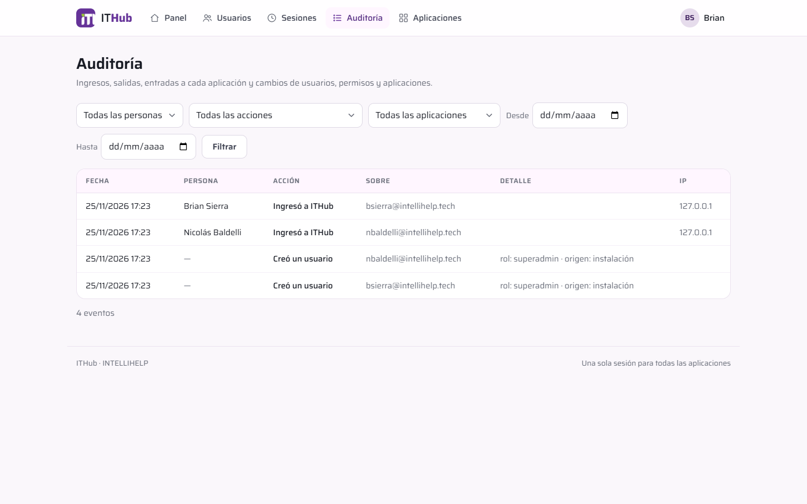</p>
<p align="center">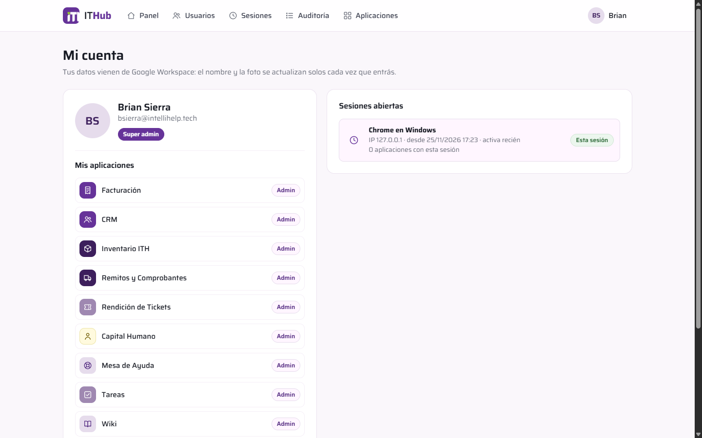</p>

### En el celular

<p align="center">
  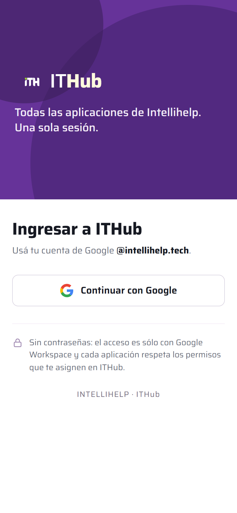
  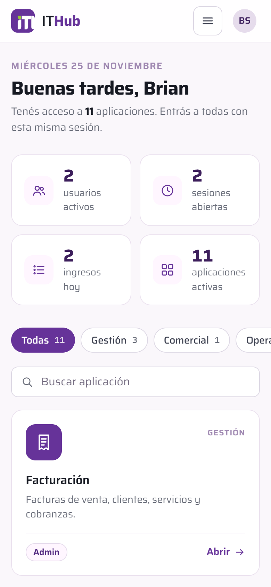
  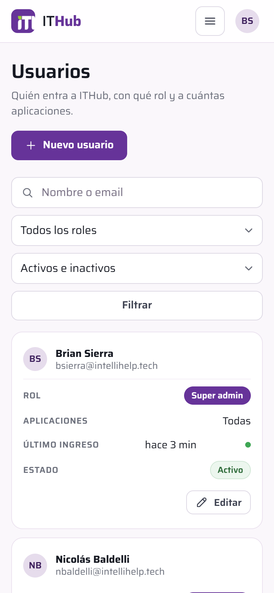
</p>

## Cómo funciona la sesión única

ITHub es un **proveedor de OpenID Connect** (el mismo estándar que usan Google y Microsoft).
Cada aplicación, en lugar de preguntarle a Google quién es la persona, le pregunta a ITHub:

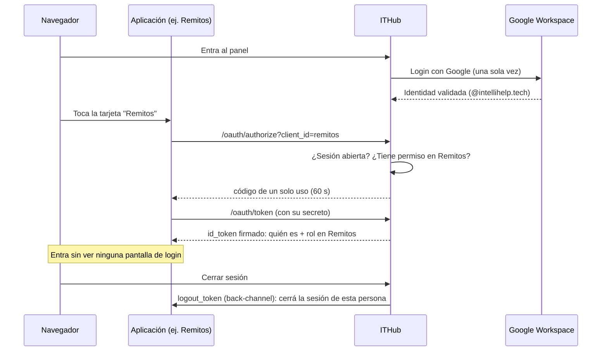

- **Códigos de un solo uso y de 60 segundos**; si alguien intenta usar uno dos veces, se
  revocan los tokens que dio.
- **`redirect_uri` con coincidencia exacta**: ITHub nunca devuelve un código a una dirección
  que no esté registrada para esa app.
- **PKCE S256**, `state`, `nonce` e `iss` en la respuesta (protección contra mezcla de
  proveedores).
- **`id_token` firmado con RS256**; la clave pública está en `/oauth/jwks` y cualquier
  librería estándar lo valida.
- **Back-channel logout**: al cerrarse una sesión, ITHub avisa a cada app a la que se entró
  con ella.

Cómo conectar una aplicación: [md/INTEGRAR-APLICACION.md](md/INTEGRAR-APLICACION.md).

## Permisos

**Por sesión (rol en ITHub):**

| Rol | Puede |
|---|---|
| Super admin | Todo: catálogo de aplicaciones y secretos, nombrar super admins. Entra a todas las apps. |
| Administrador | Usuarios, permisos por aplicación, sesiones y auditoría. No toca a un super admin. |
| Usuario | Su panel con las apps asignadas y su cuenta (sus sesiones). |

**Por aplicación:** una fila por persona y aplicación con el rol **con el mismo nombre que usa
la app** (`admin`, `operador`, `comercial`…). Llega a la app en el claim `rol` del `id_token`.

Reglas que protegen el acceso:

- Nadie se desactiva ni se cambia el rol a sí mismo, y siempre queda al menos un super admin.
- Desactivar a una persona cierra todas sus sesiones, en ITHub y en las apps.
- Quitarle una aplicación cierra su sesión **sólo en esa** aplicación.
- Una app *en mantenimiento* sólo la abren los super admin; *próximamente*, nadie.

## Aplicaciones

Catálogo inicial (se edita desde la pantalla **Aplicaciones**):

| Aplicación | Dirección | Roles | Ingreso único |
|---|---|---|---|
| Facturación | facturacion.intellihelp.tech | admin, ventas, cobranzas | etapa 2 |
| CRM | intellihelp.tech/crm | admin, comercial | etapa 2 |
| Inventario ITH | desarrollo.intellihelp.tech (empresa ITH) | admin, tecnico, viewer | etapa 2 |
| Remitos y Comprobantes | remitos.intellihelp.tech | admin, operador | etapa 2 |
| Rendición de Tickets | intellihelp.tech/comprobantes | admin, carga | etapa 2 |
| Capital Humano | rrhh.intellihelp.tech | admin, hr, manager, employee | etapa 2 |
| Mesa de Ayuda (GLPI) | ayuda.intellihelp.tech | admin, tecnico, autoservicio | etapa 3 |
| Tareas | tareas.intellihelp.tech | admin, usuario | etapa 3 |
| Wiki (Outline) | wiki.intellihelp.tech | admin, miembro, lector | etapa 3 |
| ITHOS Gestor | ithos.intellihelp.tech | admin, usuario | etapa 4 |
| Inventario · SuperAdmin | desarrollo.intellihelp.tech | superadmin | etapa 2 |

Mientras una app no está conectada, su tarjeta igual la abre (y queda en la auditoría), pero
la app pide su propio ingreso como hasta ahora.

## Stack técnico

- **PHP 8.2+** sin framework, con un *front controller* (`index.php`) y una tabla de rutas.
- **MariaDB / MySQL** en producción; **SQLite** para tests y desarrollo local (el mismo
  `schema.sql`).
- **OpenSSL** para las firmas RS256; **cURL** para Google y los avisos de cierre.
- HTML + CSS + JavaScript sin dependencias. Política de seguridad de contenido estricta
  (sin scripts ni estilos en línea).
- Hosting: **Hostinger** (servidor compartido), deploy por SSH con `bin/deploy.py`.

## Estructura del proyecto

```
app/
├── db/schema.sql                  esquema (MariaDB; los tests lo traducen a SQLite)
├── server-config/config.example.php
└── web/                           ← web root
    ├── index.php                  front controller y tabla de rutas
    ├── .htaccess                  todo a index.php, HTTPS, archivos sensibles negados
    ├── assets/                    css, js, logos
    └── app/                       código (negado por HTTP)
        ├── bootstrap.php          configuración, cabeceras de seguridad, sesión
        ├── auth.php               sesión única y roles del portal
        ├── google.php             login con Google (code + PKCE)
        ├── oidc.php               proveedor OpenID Connect
        ├── aplicaciones.php       catálogo y permisos por aplicación
        ├── jwt.php · http.php · db.php · helpers.php · auditoria.php · iconos.php
        ├── pages/                 un controlador por ruta (incluye oauth/ y well-known/)
        ├── views/                 vistas y layout
        └── cli/                   instalar.php y el catálogo inicial
bin/deploy.py                      deploy a Hostinger con swap y versiones
md/INTEGRAR-APLICACION.md          guía para conectar una app
test/run_tests.php                 batería de tests
test/router.php                    router para el servidor local de PHP
```

## Puesta en marcha

Ver [INSTALL.md](INSTALL.md). En corto, local:

```bash
cp app/server-config/config.example.php app/web/config.local.php   # driver sqlite, env dev
php app/web/app/cli/instalar.php
php -S 127.0.0.1:8090 -t app/web test/router.php
```

## Tests

```bash
php test/run_tests.php
```

45 pruebas sobre una SQLite en memoria, sin red: JWT y claves, validación de Google (dominio,
`hd`, audiencia, nonce, vencimiento), permisos por aplicación, catálogo, todo el flujo de
OpenID Connect (autorización, canje, PKCE, reuso de códigos, sesiones cerradas, credenciales
de la app), cierre de sesión en las apps, redirecciones internas y auditoría sin secretos.

Además, el flujo completo se probó por HTTP contra el servidor local, y la firma del
`id_token` se verificó con `openssl` a partir del JWKS publicado.

## Seguridad

Ver [SECURITY.md](SECURITY.md).

## Licencia

Software propietario. Ver [LICENSE](LICENSE).

## Autor

**Brian Sierra** — [bsierra@intellihelp.tech](mailto:bsierra@intellihelp.tech)
